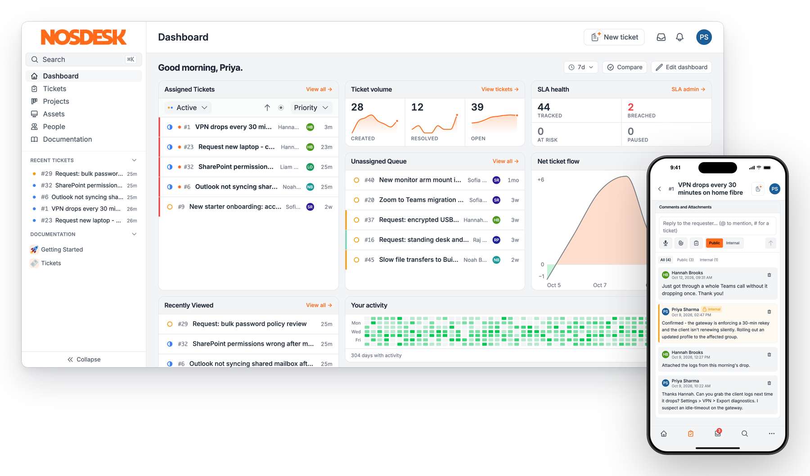

<p align="center">
  <a href="https://nosdesk.com"></a>
</p>

<h3 align="center">The helpdesk that moves as fast as you.</h3>

<p align="center">
  Tickets, projects, docs and devices in one workspace that updates live for everyone in it.<br>
  Run it on your own servers, or let Nosdesk Cloud run it for you.
</p>

<p align="center">
  <a href="https://id.nosdesk.com/signup"></a>
  &nbsp;
  <a href="https://nosdesk.com/docs/operations/installation"></a>
</p>

<p align="center">
  <a href="https://github.com/Nosdesk/Nosdesk/releases/latest"></a>
  <a href="https://github.com/Nosdesk/Nosdesk/actions/workflows/ci.yml"></a>
  <a href="LICENSE"></a>
</p>

<p align="center">
  <a href="https://nosdesk.com">Website</a> ·
  <a href="https://nosdesk.com/docs">Docs</a> ·
  <a href="https://nosdesk.com/pricing">Pricing</a> ·
  <a href="https://github.com/Nosdesk/Nosdesk/releases">Releases</a> ·
  <a href="SECURITY.md">Security</a>
</p>

## Why Nosdesk

- **Everything is live.** Two agents in the same ticket see each other's edits as they type. Lists, boards and the requester portal update without a refresh.
- **Fast.** A Rust backend does the work, and an app you come back to syncs only what changed instead of reloading.
- **Requesters are free.** Nosdesk Cloud charges per agent. The people who raise tickets, use the portal or write in as guests never count.
- **Yours to move.** The same product runs self-hosted or on Nosdesk Cloud, and a workspace owner can export the whole workspace, files included. Moving a workspace between the two, either way, comes in a 1.1 update.

<p align="center">
  <picture>
    <source media="(prefers-color-scheme: dark)" srcset=".github/assets/nosdesk-dark.png">
    
  </picture>
</p>

## What's in it

<table>
  <tr>
    <td><strong>Tickets</strong></td>
    <td>Collaborative notes, voice notes and attachments, per-workspace ticket numbers, SLAs with working calendars, merges, <code>#</code> mentions and recurring tickets.</td>
  </tr>
  <tr>
    <td><strong>Requester portal</strong></td>
    <td>A help centre, request types and forms, approvals, known-issue notices, a help widget for your own sites and a Microsoft Teams tab. Requesters sign in with an emailed code or link, or with their work account.</td>
  </tr>
  <tr>
    <td><strong>Email</strong></td>
    <td>IMAP inbound with threading, per-workspace sending domains with DKIM, a live SPF, DKIM, DMARC and MX check, bounce matching and one-click unsubscribe.</td>
  </tr>
  <tr>
    <td><strong>Rules and saved replies</strong></td>
    <td>Rules an agent applies from a ticket, with every step previewed before it runs. Assignment rules on every new ticket, saved replies, and a log of what each rule changed.</td>
  </tr>
  <tr>
    <td><strong>Notifications</strong></td>
    <td>Instant, digest or off for each type, with workspace defaults, and an inbox that tracks seen, read, archived and snoozed.</td>
  </tr>
  <tr>
    <td><strong>Projects</strong></td>
    <td>Kanban boards, cycles and a Gantt timeline, next to the tickets they come from.</td>
  </tr>
  <tr>
    <td><strong>Docs</strong></td>
    <td>A knowledge base built from real work: turn a ticket note into a page, restrict pages and collections, and see the questions your docs don't answer yet.</td>
  </tr>
  <tr>
    <td><strong>Devices</strong></td>
    <td>Assets synced from Microsoft Intune, a model catalogue, lifecycle history and device loans with due-back reminders.</td>
  </tr>
  <tr>
    <td><strong>Identity</strong></td>
    <td>Local accounts with MFA and passkeys, Microsoft Entra ID, OpenID Connect providers with discovery, and LDAP or Active Directory sync with group-to-role mapping.</td>
  </tr>
  <tr>
    <td><strong>Plugins</strong></td>
    <td>Every plugin runs in a sandboxed frame with the permissions it asked for. Plugins add dashboard widgets, pages, ticket actions and settings pages.</td>
  </tr>
  <tr>
    <td><strong>Mobile</strong></td>
    <td>One app for iOS and Android with the whole product: photo and voice capture, native uploads and push notifications. Store links will be on nosdesk.com once the listings are live.</td>
  </tr>
</table>

## Get started

### Nosdesk Cloud

[Start a 14-day trial](https://id.nosdesk.com/signup). Your workspace gets its own address, can use a custom domain, and sends and receives email from its own support address. Plans are on the [pricing page](https://nosdesk.com/pricing).

### Self-hosted

Nosdesk is one Docker image, run alongside PostgreSQL 18 and Redis. There is nothing to compile and no repository to clone: create a `compose.yaml` and a `.env` from the [install guide](https://nosdesk.com/docs/operations/installation), then start the stack.

```bash
mkdir nosdesk && cd nosdesk
# add compose.yaml and .env from the install guide, then:
docker compose up -d
```

A 2 vCPU, 2 GB host is enough to start. The guide covers TLS, the first admin account and updates. Self-hosted Nosdesk is free for one workspace; a [licence](https://nosdesk.com/docs/operations/licensing) adds more.

> [!IMPORTANT]
> **Upgrading from 1.0?** 1.1 needs PostgreSQL 18 and refuses to start on 17, leaving your data untouched. Follow [Upgrading PostgreSQL](https://nosdesk.com/docs/operations/installation#upgrading-postgresql) and read the [1.1.0 release notes](https://github.com/Nosdesk/Nosdesk/releases/tag/v1.1.0) first.

<details>
<summary>Build from source instead</summary>

Clone this repository, copy `.env.example` to `.env` and fill in the secrets it lists, then run `docker compose up -d --build`. The stack listens on http://localhost:8080.

</details>

## Built with

<table>
  <tr><td><strong>Backend</strong></td><td>Rust, Actix Web, PostgreSQL 18, Redis</td></tr>
  <tr><td><strong>Web</strong></td><td>Vue 3, TypeScript, Tailwind CSS</td></tr>
  <tr><td><strong>Real time</strong></td><td>Yjs, ProseMirror, WebSockets, Server-Sent Events</td></tr>
  <tr><td><strong>Mobile</strong></td><td>Tauri 2 for iOS and Android</td></tr>
</table>

## Contributing and development

[DEVELOPMENT.md](DEVELOPMENT.md) covers the dev stack. In short:

```bash
make dev    # the full stack with hot reload, at http://localhost:8080
make test   # backend tests
```

Found a bug? [Open an issue](https://github.com/Nosdesk/Nosdesk/issues). Found a vulnerability? Report it privately, as [SECURITY.md](SECURITY.md) describes.

## License

Nosdesk is source-available under the [Business Source License 1.1](LICENSE). Run it to support your own customers, users or members, including letting them submit and follow tickets. What the license rules out is selling Nosdesk as a helpdesk service that other organisations run their own helpdesk on. On 29 October 2029 the code converts to the GNU AGPL v3. [LICENSING.md](LICENSING.md) explains editions and licence keys.

Copyright (c) 2026 Nosdesk Pty Ltd.

Nosdesk&trade; and the Nosdesk logo are trademarks of Nosdesk Pty Ltd. The license above grants no right to use these marks (see the trademark reservation in the [LICENSE](LICENSE)); you may not use the Nosdesk name or logo to brand a derivative or fork in a way that implies endorsement or affiliation.
